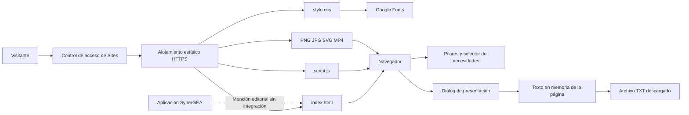
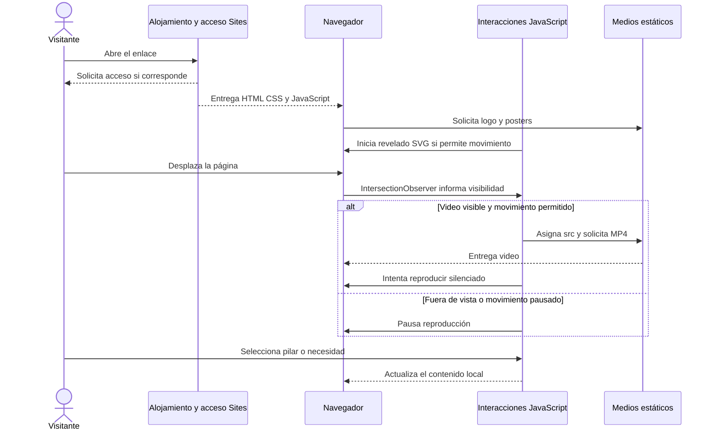
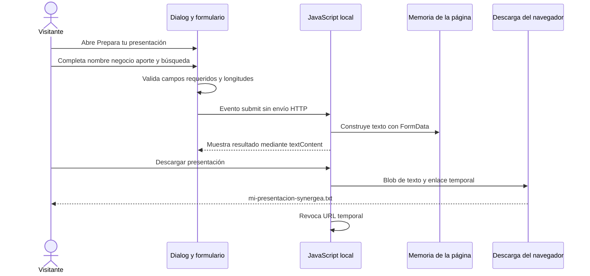
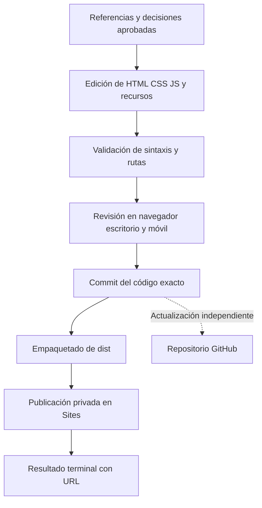

# Arquitectura implementada

La solución actual es una web estática. El navegador solicita los archivos y ejecuta las interacciones. El alojamiento de Sites aplica el acceso privado; el código de la web no autentica visitantes ni consulta servicios de negocio.

## Componentes

La aplicación queda fuera del flujo ejecutable. No se conocen su arquitectura, autenticación, API, almacenamiento o plataforma; no se dibujan como componentes existentes de esta web.

## Carriles del sistema

## Carriles de presentación personal

No se almacena en localStorage, no se envía por correo y no se registra un prospecto. La página no debe mostrar mensajes como “solicitud recibida”.

## Movimiento y accesibilidad

- SVG contiene una imagen raster enmascarada; el path normalizado revela azul, unión y rosa en unos 5.2 segundos.
- Un rectángulo final completa la máscara para evitar regiones omitidas. Es revelado visual, no reconstrucción geométrica del logotipo.
- `prefers-reduced-motion` evita la animación y la reproducción inicial de los videos.
- El botón de movimiento pausa los medios; los controles nativos permiten operar el video de la ciudad.
- Pestañas con roles y navegación por flechas; formularios etiquetados; dialog nativo; resultado de selector con `aria-live`.
- En móvil se apilan las columnas. La ciudad usa `aspect-ratio: 9/16` y `object-fit: contain`.

## Flujo de mantenimiento

No hay CI/CD de GitHub configurado en este paquete. Subir cambios a GitHub no publica automáticamente en Sites.
