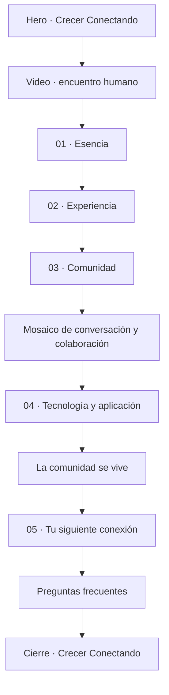
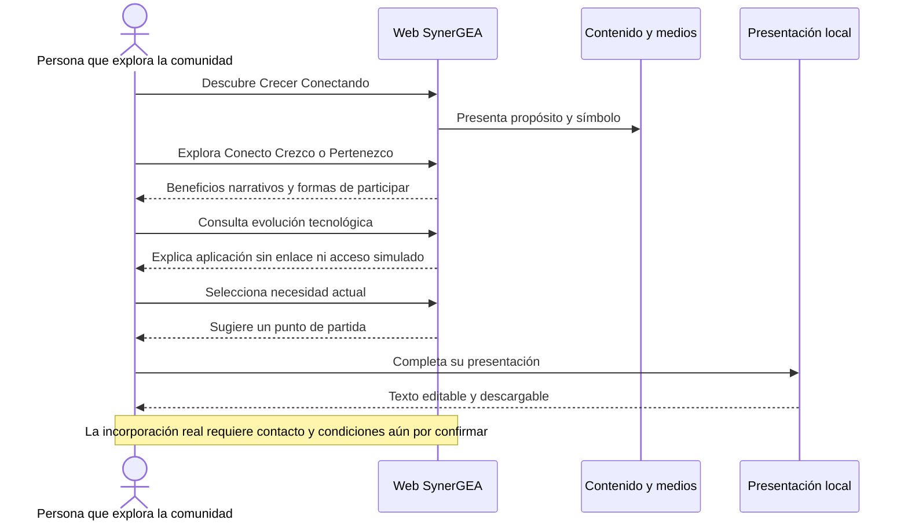

# Arquitectura de información y usuario

## Recorrido editorial

El hero expresa propósito; las escenas humanas concretan la promesa; los pilares explican qué valor buscar; tecnología comunica continuidad; la invitación permite una acción pequeña y útil.

## Carriles del usuario

## Acciones y resultados

| Elemento | Resultado implementado | Interpretación correcta |
|---|---|---|
| Quiero ser parte | Ancla a sección 05 | Intención de explorar; no solicitud enviada. |
| Pilares | Cambia contenido visible | Interés en una dimensión del valor. |
| Selector de necesidad | Modifica recomendación | Preferencia local; no segmentación guardada. |
| Ver cómo conectamos | Repite animación | Exploración de identidad. |
| Prepara tu presentación | Abre dialog | Inicio de una herramienta local. |
| Crear mi presentación | Produce texto | No registro ni conversión comercial. |
| Descargar | Guarda TXT | Resultado útil; no membresía adquirida. |
| Preguntas frecuentes | Despliega respuestas | Consulta de información. |

## Oportunidades de mejora

- El CTA “Quiero ser parte” puede crear expectativa de incorporación. Mantener la aclaración actual o cambiarlo al incorporar un contacto real.
- La página es larga: medir profundidad de desplazamiento antes de eliminar contenido o duplicar CTAs.
- El video vertical aporta contexto visual, pero aumenta altura en móvil. Medir si desplaza demasiado la herramienta; no cambiar su encuadre 9:16 para resolverlo.
- Evaluar si los pilares se comprenden sin explicar los símbolos y si la sección tecnológica mantiene el foco humano.
