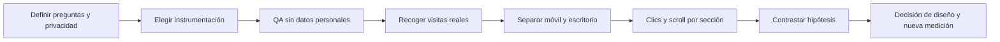

# Mapas de calor y zonas de atención

## Estado de evidencia

**No hay mapas de calor medidos de esta web.** El código no incluye servicios de analítica ni captura de clics, scroll, movimientos o sesiones. No se conocen tráfico, dispositivos, usuarios, fechas de observación ni muestras.

El [mapa esquemático interactivo](mapa-atencion.html) representa **hipótesis editoriales**, con dos dimensiones separadas: atención visual esperada y relevancia para la acción. No genera porcentajes, densidades de clics ni datos de visitas.

## Hipótesis por zona

| Zona | Atención prevista | Relevancia de acción | Hipótesis y riesgo a comprobar |
|---|---|---|---|
| Lema y símbolo del hero | Alta | Media | Tamaño, gradiente y animación pueden dominar la primera mirada. Pueden competir con el CTA. |
| Quiero ser parte | Media | Alta | Contraste del botón facilita encontrarlo; comprobar expectativa de incorporación. |
| Video humano | Alta | Baja | Rostros y movimiento aportan contexto; pueden distraer de la narrativa. |
| Esencia | Media | Baja | El cambio a fondo claro puede renovar atención; comprobar comprensión del propósito. |
| Pilares | Alta | Alta | Composiciones luminosas y pestañas invitan a explorar; medir cuál se abre. |
| Comunidad y mosaico | Alta | Media | Personas y textos de pertenencia pueden aumentar implicación; no asumir permanencia. |
| Aplicación y tecnología | Alta | Media | Luz y símbolo pueden llamar la atención; comprobar si se entiende que el acceso no está disponible aquí. |
| La comunidad se vive | Media | Media | Fotografía acompaña actividades; comprobar lectura de beneficios concretos. |
| Ciudad vertical en sección 05 | Alta | Baja | Movimiento puede atraer la mirada; puede competir con contenido y controles de la derecha. |
| Selector y presentación | Media | Alta | Acción útil con pasos claros; medir apertura, finalización y descarga por separado. |
| FAQ y cierre | Media | Media | Imágenes facilitan continuidad visual; comprobar si se llega a estas zonas. |

“Alta” y “media” son categorías de revisión, no mediciones. Una zona visualmente intensa no necesariamente produce una acción.

## Medición propuesta sin implementar

| Evento propuesto | Atributos permitidos | Pregunta |
|---|---|---|
| section_view | section_id, categoría de pantalla | ¿Hasta dónde llega la visita? |
| hero_cta_click | cta_id | ¿Se identifica la siguiente acción? |
| pillar_select | connect / grow / belong | ¿Qué dimensión del valor se explora? |
| need_select | conectar / aprender / pertenecer | ¿Qué necesidad expresa el visitante? |
| intro_open | ubicación del CTA | ¿Se descubre la herramienta? |
| intro_complete | solo resultado booleano | ¿Se completa el formulario? |
| intro_download | solo nombre de evento | ¿Se obtiene el archivo? |
| faq_open | pregunta por identificador | ¿Qué información falta? |
| motion_toggle | pausado / activo | ¿El movimiento resulta molesto? |

No registrar nombre, negocio, textos de aporte o búsqueda, contenido descargado ni valores de campos. El formulario y su resultado deben quedar excluidos de grabaciones o capturas. Elegir proveedor, consentimiento, retención y acceso antes de recoger datos; ese cambio no forma parte de esta entrega.

## Cómo leer un mapa real

Registrar periodo, visitas válidas, tamaño de pantalla, ruta y versión del sitio. Normalizar por dimensiones y separar dispositivos. Distinguir clics en controles de clics sobre elementos decorativos. Revisar pérdida de usuarios por secciones y errores de reproducción; no inferir intención de compra a partir de movimiento del cursor.

No hay un umbral de muestra inventado: decidirlo según tráfico, estabilidad y la pregunta del estudio. Si los datos son insuficientes, reportar incertidumbre y complementar con sesiones de usabilidad consentidas.
